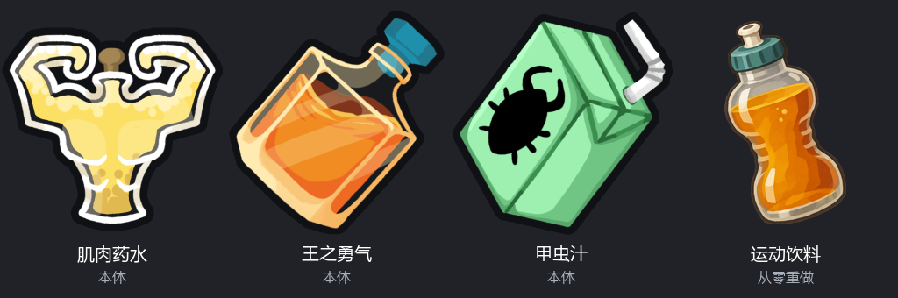
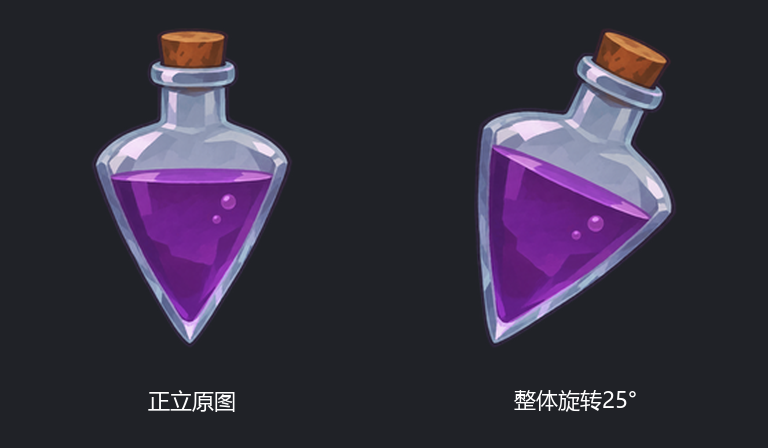
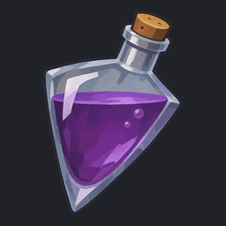
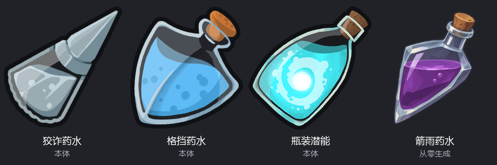
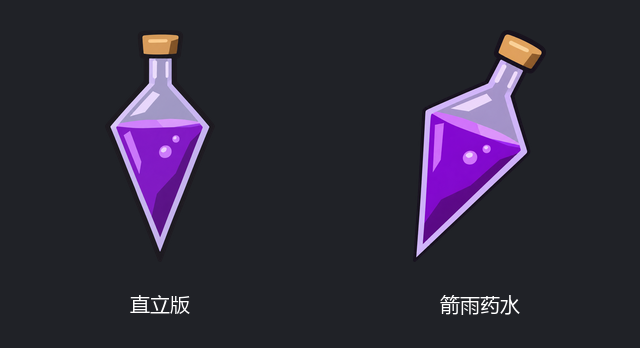
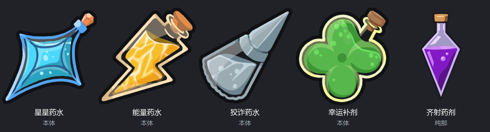
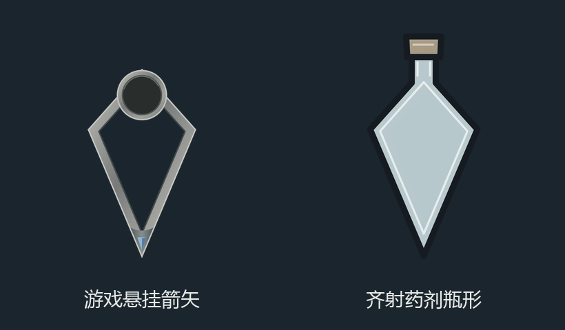

# 职业药水图标

工作台r4999使用从零重做的运动饮料v10；箭雨药水沿用v9，知识药水沿用v2。

| 稀有度 | 名称 | 成品 | 表现 |
| --- | --- | --- | --- |
| 普通 | 知识药水 | [knowledge_potion.png](v2/icons/knowledge_potion.png) | 蓝色扁瓶内的纸卷 |
| 罕见 | 运动饮料 | [sports_drink.png](v10/icons/sports_drink.png) | 收腰运动瓶、蓝绿色旋盖与推拉壶嘴、橙金饮料 |
| 稀有 | 箭雨药水 | [arrow_rain_potion.png](v9/icons/arrow_rain_potion.png) | 正立绘制后整体旋转的实体箭头形药瓶 |

## 运动饮料从零重做

先重新逐张检查本体全部63张药水的形状、配色和装饰，按“用轮廓或一个主要物件表达主题，再用简洁材质画法统一为药水”设计新运动瓶。完整依据见[运动饮料设计分析](../../../../worktree-tasks/junna-potions-workbench-20261111/sports-drink-redesign.md)，[63图复核](v10/native-review.json)确认全部源图同摘要。

新图采用上下饱满、中腰收窄的握持结构，蓝绿色旋盖和同轴推拉壶嘴，橙金色饮料与浅色玻璃壁。名称及“所有手牌获得9点伤害加成。”保持原样。内置image_gen从空白画布生成正立图，未输入旧运动饮料；原尺寸清理后整体向左倾斜18度，倾斜阶段不重绘。[完整提示词](v10/generation-prompts.json)、[原图](v10/originals/sports_drink_upright.png)、[正立清理成品](v10/cleaned-native/sports_drink_upright.png)、[倾斜成品](v10/cleaned-native/sports_drink.png)、[正立与倾斜对照](v10/upright-to-tilted.png)均保留。

本地Artifact Cleaner使用strength 0.25、interior_blend 0.25，透明通道和深色轮廓保持一致；[清理记录](v10/cleanup.json)、[旋转矩阵](v10/rotation.json)、[变换核对](v10/rotation-verification.json)、[32／64像素检查](v10/cleanup-and-size-review.png)、[线上摘要核对](../../../../worktree-tasks/junna-potions-workbench-20261111/public-art-v10-verification.json)均已保存。旋转脚本增加-Key参数，原箭雨药水默认参数保留。

## 当前箭雨药水正立再旋转版

v9先用内置image_gen从零生成正立药瓶，瓶口水平、瓶颈和木塞垂直同轴。原尺寸完成Artifact Cleaner清理后，再用System.Drawing GDI+对同一张图整体顺时针旋转25度；倾斜阶段不重新生成或重画瓶口。变换矩阵已核对为纯旋转，无缩放和剪切，正立源文件未变，旋转后的尖端未裁切。

[完整提示词](v9/generation-prompts.json)、[正立生成原图](v9/originals/arrow_rain_potion_upright.png)、[正立清理成品](v9/cleaned-native/arrow_rain_potion_upright.png)、[旋转成品](v9/cleaned-native/arrow_rain_potion.png)、[工作台图标](v9/icons/arrow_rain_potion.png)均保留。Artifact Cleaner使用strength 0.25、interior_blend 0.25；清理记录见[v9/cleanup.json](v9/cleanup.json)。[旋转参数与矩阵](v9/rotation.json)、[变换验证](v9/rotation-verification.json)、[32／64像素检查](v9/cleanup-and-size-review.png)、[线上摘要核对](../../../../worktree-tasks/junna-potions-workbench-20261111/public-art-v9-verification.json)均已保存。旋转脚本为docs/worktree-tasks/junna-potions-workbench-20261111/rotate-potion.ps1，参数为-Base docs/design/assets/potions/2026-11-11/v9 -Degrees 25。

## v8瓶口透视

v8按瓶口反馈从零重生成，瓶口、瓶颈与短木塞保持同轴，瓶沿和木塞顶面采用一致的透视方向；保留整瓶倾斜、尖角、侧壁、厚玻璃底及紫色药液。

内置image_gen生成时未输入旧图。[完整提示词](v8/generation-prompts.json)、[原图](v8/originals/arrow_rain_potion.png)、[原尺寸清理成品](v8/cleaned-native/arrow_rain_potion.png)、[工作台图标](v8/icons/arrow_rain_potion.png)均保留。本地Artifact Cleaner使用strength 0.25、interior_blend 0.25，保留透明通道和深色轮廓；记录见[v8/cleanup.json](v8/cleanup.json)。[原尺寸与32／64像素检查](v8/cleanup-and-size-review.png)、[公开快照与摘要核对](../../../../worktree-tasks/junna-potions-workbench-20261111/public-art-v8-verification.json)均完成。

## v7实体药瓶版

v7按用户澄清从零生成，生成工具未接收旧图或其他输入图片。参照狡诈药水等本体物件的结构表达，保留尖角，通过三分之四视角中的侧壁、厚玻璃底、环形瓶沿、圆筒瓶颈和嵌入木塞表现实体容积。瓶内药液具有水平液面，上部留出空腔。

内置image_gen的[完整提示词](v7/generation-prompts.json)、[原图](v7/originals/arrow_rain_potion.png)、[原尺寸清理成品](v7/cleaned-native/arrow_rain_potion.png)和[工作台图标](v7/icons/arrow_rain_potion.png)均保留。Artifact Cleaner使用strength 0.25、interior_blend 0.25，保留透明通道和深色轮廓，记录见[v7/cleanup.json](v7/cleanup.json)。[原尺寸与32／64像素检查](v7/cleanup-and-size-review.png)、[线上摘要核对](../../../../worktree-tasks/junna-potions-workbench-20261111/public-art-v7-verification.json)均完成。v6圆角方案未发布，原图与处理记录保留于v6/，纠正原因见[v6/review.json](v6/review.json)。

## v5倾斜版

箭雨药水以常用名词“箭雨”对应一次打出所有箭矢。v5保留已确认的菱形瓶身、紫色药液、木塞与气泡，整体顺时针倾斜约25度，瓶口向右上，长尖端向左下。

使用内置image_gen编辑v4成品，[提示词](v5/generation-prompts.json)、[原图](v5/originals/arrow_rain_potion.png)、[原尺寸清理成品](v5/cleaned-native/arrow_rain_potion.png)、[256像素图标](v5/icons/arrow_rain_potion.png)均保留。Artifact Cleaner的strength与interior_blend均为0.25，处理记录见[v5/cleanup.json](v5/cleanup.json)；原尺寸与32／64像素检查见[v5/cleanup-and-size-review.png](v5/cleanup-and-size-review.png)。名称、相关风格引用和配图通过同一MCP事务保存，公开快照与图片摘要核对见[public-art-v5-verification.json](../../../../worktree-tasks/junna-potions-workbench-20261111/public-art-v5-verification.json)。

## v4直立版重绘

先逐张观察本体63张药水图标的形状、颜色和装饰，再从成图归纳“以一个主要识别点组织图标”的方式。完整逐项记录见[本体药水图标分析](../../../../worktree-tasks/junna-potions-workbench-20261111/native-potion-icon-design.md)。齐射药剂由悬挂箭矢的菱形轮廓承担主题，瓶内只保留紫色药液、少量气泡和高光。

本次使用内置image_gen，以确认瓶形PNG为形状参照、本体接触表为风格参照。[完整提示词](v4/generation-prompts.json)、[原图](v4/originals/salvo_potion.png)、[原尺寸清理成品](v4/cleaned-native/salvo_potion.png)、[工作台图标](v4/icons/salvo_potion.png)均保留。Artifact Cleaner使用strength 0.25、interior_blend 0.25，对alpha≥250的浅色内部混合清理RGB，保留原alpha与深色轮廓；输入alpha最大为254，处理脚本已兼容近不透明像素。参数和摘要见[v4/cleanup.json](v4/cleanup.json)，原尺寸与32／64像素核对见[v4/cleanup-and-size-review.png](v4/cleanup-and-size-review.png)。线上图片与本地成品同摘要，见[发布核对](../../../../worktree-tasks/junna-potions-workbench-20261111/public-art-v4-verification.json)。

## 早期SVG瓶形

- [运动饮料SVG](shape-drafts/sports_drink.svg)：长瓶身、短颈与旋盖。
- [箭雨药水瓶形SVG](shape-drafts/hanging-arrow-v3/salvo_potion.svg)：沿用游戏悬挂箭矢上短下长的细菱形，瓶口接在上端。

SVG使用固定坐标路径，PNG预览经过本地Artifact Cleaner处理，透明轮廓保持一致。原先的扁瓶草图和各版生成稿一并保留。

## 命名依据

知识药水沿用本体直接以资源或机制命名普通药水的方式。运动饮料采用日常训练中已有的具体补给物件名，对应伤害加成体系的日常锻炼。箭雨药水采用常用意象“箭雨”，对应一次打出所有箭矢。

## 本体对照与重绘

[native-style-reference.png](native-style-reference.png)汇集9张本体原尺寸图标：攻击药水、力量药水、狡诈药水、瓶装潜能、瓶中船、骨头酿、星星药水、灰水、王之勇气。原图来自`<vanilla-extraction>/extraction/raw/images/potions/`。

v2以这些实际图标作风格参照，重绘瓶形、玻璃边线、高光和阴影色块。箭雨图改用完整木杆箭矢与箭羽，明确区分箭头符号与实体箭矢。对照见[v2/native-comparison.png](v2/native-comparison.png)，小尺寸核对见[v2/small-size-native-review.png](v2/small-size-native-review.png)。

## 生成与处理

- 生成工具：内置`image_gen`；v2通过本体原图参照进行style-transfer重绘，输出透明背景。完整提示词及输入图片角色记录见[v2/generation-prompts.json](v2/generation-prompts.json)。
- 原图：`v2/originals/`；原尺寸清理成品：`v2/cleaned-native/`；工作台成品：`v2/icons/`。
- 本地工具：GPT Image 2 Artifact Cleaner，LatentR（R_ema）与Flux2 VAE，CUDA bfloat16。strength 0.25，interior_blend 0.25。
- 在生成原尺寸清理RGB，保留完整alpha及深色轮廓；清理后主体最长边缩至232像素，居中导出256×256。逐张尺寸、摘要和透明轮廓校验见[v2/cleanup.json](v2/cleanup.json)。
- 已按原尺寸对比卷轴、壶嘴、玻璃和箭杆／箭羽边缘，见[v2/native-cleanup-comparison.png](v2/native-cleanup-comparison.png)；已检查32／64像素显示。
- 首版位于本目录的`originals/`、`cleaned-native/`、`icons/`，与首版提示词和处理记录一并保留。
- 本地处理脚本为`docs/worktree-tasks/junna-potions-workbench-20261111/process_potion_art.py`。运行参数：`--config <artifact-cleaner-config> --base docs/design/assets/potions/2026-11-11/v2`。工作台提交脚本使用配置好的MCP客户端作为参数，数据通过MCP保存。
- 工作台最终资产ID及文件映射见[v2/manifest.json](v2/manifest.json)；线上图片与本地成品逐字节同摘要的记录见[public-art-v2-verification.json](../../../../worktree-tasks/junna-potions-workbench-20261111/public-art-v2-verification.json)。

按稀有度并排对比：左三列为本体、右一列为纯那，见[v2/vanilla-junna-side-by-side.png](v2/vanilla-junna-side-by-side.png)。全部图标使用相同画布和缩放比例，来源摘要记录在[v2/vanilla-junna-comparison.json](v2/vanilla-junna-comparison.json)。
