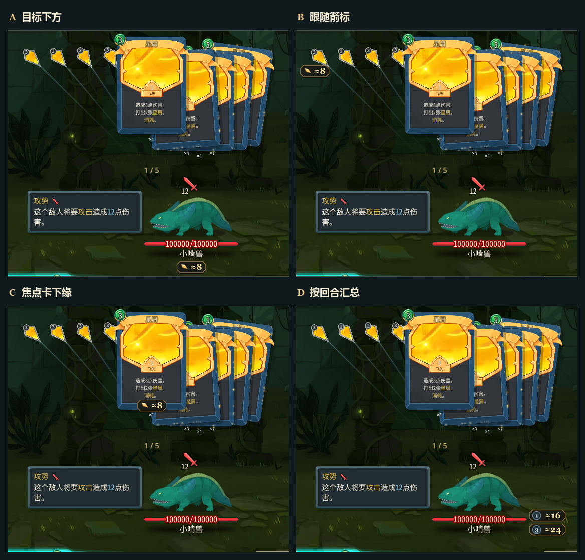

# 飞矢伤害预览

前期悬停草案。当前按用户方向采用 [直接显示在敌方血条、按回合分段的方案](health-bar-design.md)。

**悬停时，在目标名字下方显示当前焦点飞矢的预估伤害。** 上方飞矢继续用原有数字表示剩余回合。示意中，敌人头顶的红剑 `12` 是它的攻击意图，脚下的金色飞矢 `≈8` 是它将受到的伤害预览。

图用既有纯那实机截图叠加标记。焦点星屑显示的是本次直接伤害，随后生成的星屑各自等待、结算。底图见既有[悬停定位任务记录](../arrow-preview-position-20261117/README.md)及其交付目录中的 `final-hover.png`。

## 游戏界面参考

| 游戏 | 画面观察 | 取用 |
| --- | --- | --- |
| 《杀戮尖塔 2》 | 战斗中，意图和生命条分别贴着敌人的头顶与脚下，敌方攻击用红剑和数字表达。官方多人实机画面和本项目的截图可对照。 | 伤害信息继续跟随敌人。用飞矢自身的金色箭头标记玩家这侧的延时伤害，和头顶来自敌人的攻击分开读。[Mega Crit 实机画面](https://www.megacrit.com/news/2026-03-05-early-access-launch/) |
| 《陷阵之志》 | 敌人的攻击提前标在棋盘上，方向和覆盖范围附着在将生效的位置。 | 飞矢到目标的联系继续由现有导线表达。悬停群体飞矢时，把不同的伤害数值分别放在对应敌人身边。[Subset Games 战斗画面与说明](https://store.epicgames.com/p/into-the-breach?lang=en-US) |
| 《火焰纹章 Engage》 | 确认攻击前可看双方战后预计 HP 和出手顺序。 | 按当前操作焦点展示预测。飞矢的时间仍由倒计时提供，伤害标记只补充当下可算的攻击值及命中次数。[任天堂战斗预测说明](https://www.nintendo.com/jp/topics/article/4845983f-8424-4ce7-8bca-1980b90e9399) · [原版战斗预测截图](https://assets.topics.apps-jp.nintendo.com/image/2022/12/20033126937020/1280/23.jpg) |

## 四种战斗内布局

A、B、C 使用同一张悬停截图。D 在相同画面中示意两支 1 回合飞矢和三支 3 回合飞矢。每支按 8 点算，两个批次分别是 `≈16` 和 `≈24`。

| 方案 | 平时显示 | 查看时显示 | 适合的判断 |
| --- | --- | --- | --- |
| A · 目标下方 | 现有箭标和倒计时 | 当前焦点飞矢的数值贴在目标名字下方。直接查看群体飞矢时，按敌人分别显示。 | 一眼判断这支箭会打到谁、对谁更疼。切换卡扇焦点时，目标边只更新一组相应数值。 |
| B · 跟随箭标 | 倒计时为 1 的单体飞矢可在箭标下露出一个小伤害牌匾。重叠时优先保留焦点值，同一挤压区域最多一枚。 | 当前焦点单体飞矢即使还要等几回合，也显示自己的数值。群体飞矢在悬停具体敌人时按该敌人给数。 | 扫箭列就能找到快落地的一支。比较不同敌人时还要沿现有导线找目标。 |
| C · 焦点卡下缘 | 现有箭标和倒计时 | 伤害牌匾嵌在焦点卡框底边，卡名、描述和组内数量仍各在原位置。选中敌人时显示该敌人的值。直接悬停群体飞矢时，展示当前各目标的范围，例如 `≈8–12`。 | 集中读这一张牌，尤其是多段或额外命中。标签和卡面一起移动，密集敌人场景也无需给每个目标找摆放位置。 |
| D · 按回合汇总 | 现有箭标和倒计时 | 悬停敌人时，在血条侧列出最近两档倒计时和每档的合计。示例为蓝色 `1` 配 `≈16`、蓝色 `3` 配 `≈24`。切换卡扇焦点时汇总保持稳定。 | 看这个敌人在下一批箭落地时会吃到多少伤害，便于判断要不要加速。逐支效果仍可从卡扇查看。 |

A 作为默认方案。实际战斗里，玩家只需把视线从敌人的血量往下移一点，也能直接看出同一支群体箭在多个目标上的差异。C 的布局最容易复用现有卡扇。B 适合把注意力放在快落地的箭上，D 更适合飞矢数量大且需要规划加速的情况。

B 若遇到牌匾遮住相邻箭标或原生预览卡，则优先收起挤压的牌匾。C 的牌匾随焦点卡缩放和转动，卡框底边避开原有组内数量。D 给每个敌人独立统计，对相同倒计时下的每个实际部署只计算一次。汇总仅覆盖当前战况能完整计算的直接伤害，若该批次含无法定目标或无法确定先后影响的伤害，则这档保留倒计时、伤害显示 `?`。D 的两档占用血条侧边空间，侧边紧凑时整体放到名字下方。

## A 方案的战斗内交互

| 玩家操作 | 战场反馈 |
| --- | --- |
| 平时扫视战场 | 读取原有飞矢倒计时、敌人意图与生命条。 |
| 悬停一支单体飞矢 | 展开原生卡面，在它的当前目标下显示一个伤害标记，例如 `≈8`。 |
| 悬停敌人 | 现有卡扇展开。敌人下方只显示当前焦点卡对它的伤害。滚轮切牌或移入卡扇选中邻牌时，数字随焦点切换。 |
| 直接悬停群体飞矢 | 每个当前可命中的敌人显示自己的值，例如左敌 `≈8`、右敌受易伤 `≈12`。 |
| 移开、开始拖牌或进入选敌 | 与原飞矢悬停预览一起收起。飞矢开始结算时立即清掉它的预览。 |

标记用小金色飞矢头、浅金数字和窄深色底。参考尺寸为 1280×720 下约 24 像素高、17～18 像素字号，宽度随数字变化。用原有 HUD 缩放和字形，沿目标生命条居中，放在名字和常驻状态图标的下边缘之外。多人或狭窄画幅先尝试沿同一锚点短距离错位，仍碰到血条、状态、提示或手牌时隐藏冲突项。标记让鼠标穿透，原卡扇继续处理滚轮和焦点。

## 伤害口径

**`≈` 表示按当前战况估算、格挡吸收前的直接伤害。** 采用已部署牌实例与当前目标。力量、虚弱、易伤、飞矢已获得的伤害投入和「沸腾的热情」等修正按实际伤害结算顺序计算。敌人有 6 格挡时，`≈8` 仍显示 8。格挡可能在飞矢落地前变化，血条保留当前生命值。

| 场景 | 显示规则 |
| --- | --- |
| 单段或等伤害多段 | `≈8` 表示一段，`≈8×3` 表示每段约 8、共三段。读取已知的等待期间加段、额外命中和重放次数。原生规则若让各段依赖命中后的状态变化，只展示能完整确定的情况。 |
| 两段伤害不同 | 可靠且能在标记内读清时，按顺序写 `≈8+5`。更复杂的伤害序列由卡面说明。 |
| 同组星屑 | 卡面既有的 `×N` 表示该组有几支箭。A、B、C 的焦点数值按单支计算。D 按实际部署逐支并入对应的倒计时档。复制的部署、重放、单次结算的额外命中各自按结算语义读取。 |
| 等待期间变化 | 倒计时、投入、卡牌实例数值、相关能力或目标变化后更新。只计算当前可见标记需要的飞矢和目标。移动和缩放只更新标记的位置。 |
| 改目标或目标暂时不可命中 | 原目标失效就清掉旧标记。真实逻辑完成改目标后，对新目标重新计算。 |
| 随机或条件伤害、间接伤害、辅助飞矢 | 直接伤害的目标、伤害值或段数不可确定时，留原生卡面供查看。不为随机命中者标出假定伤害。能力、后续生成物或连锁伤害由各自的实际效果承担。 |

## 实现落点与定向验收

- 挂在 [现有飞矢悬停逻辑](../../../src/UI/Arrows/ArrowHud.Hover.cs)，用 `_inspectedArrow`、`_previewTarget` 和现有关闭条件同步显示。单体用部署上实际保存的目标，群体按实际伤害命令的目标规则逐个计算。结算前的目标变更以真实战斗规则为准。[部署与范围规则](../../../src/Combat/Arrows/ArrowDeployment.cs) · [改目标与群体攻击](../../../src/Combat/Arrows/ArrowCombat.Targeting.cs)
- 优先复用 [原生卡面伤害计算与纯那修正](../../../src/Combat/Damage/DamagePatches.cs)。仅对能从实际效果还原直接伤害段的飞矢输出标记，卡牌类型或伤害变量本身不足以确定伤害段。用已存的 X 值、投入快照和重放信息，每段按实际规则取整。逐目标求值的临时结果与原生卡面已有的预览状态独立。额外命中在每次卡牌结算内只归到实际领取它的伤害段。不要通过运行 `AttackCommand.Execute` 或飞矢效果读取预览，以免消耗随机数、改动状态或触发效果。[伤害执行](../../../src/Combat/Damage/DamageExecution.cs) · [伤害与段数修正](../../../src/Combat/Damage/DamageModifiers.cs)
- 用已部署星屑做第一次端到端对照。对比无修正、力量／易伤和有格挡时，标记与同状态下实际结算的格挡前数值。再验证多段与重放、群体逐目标、死亡改目标、无伤害牌、切牌及拖牌隐藏。对转化牌与未知效果，先验证是否满足同一预览口径，再开启数值。现有 [伤害探针](../../../tests/Integration/DamagePreviewProbe.cs) 和 [悬停放置探针](../../../tests/Integration/ArrowPreviewPlacementProbe.cs) 可作为定向入口。
