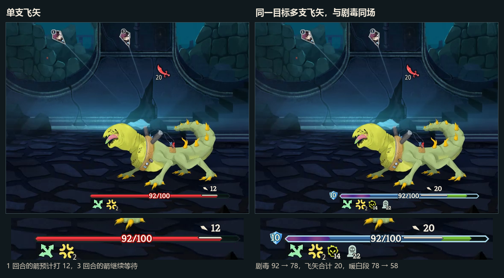

# 敌方血条的飞矢伤害预览

当前实现按实际剩余回合汇总已部署飞矢的直接伤害。每批分别用当前生命、当前格挡和已生效状态计算。待命中的飞矢所施加的易伤等状态要等实际生效才计入。剧毒、厄运和正在等待的敌方行动按本体显示。下方保留了早期的血条覆盖示意和先扣毒口径。

**同一敌人的飞矢按回合分段。** 标线底边贴原生血条上沿，最近的批次从当前血量末端向左起排。缩小的完整飞矢外框内显示一位剩余回合数，旁边是该批预计掉血整数。

左图下回合只有一支箭，目标处显示 `12`。右图两支同回合落地，读数仍在目标上方，合计为 `20`。右图以毒发后 `78` 为该批飞矢起点，按敌人存活、未新增格挡的例子画到 `58`。画面取自[实验体定向录像](../experiment-death-zero-arrows-20261118/README.md)，血量和投影为静态示例。

## 数字和白段放在一起

| 摆法 | 适合的读法 | 综合判断 |
| --- | --- | --- |
| 实际箭标旁 | 看清哪支单箭下回合打多少。 | 多支、群体和重叠箭标会让数字需要另找位置，玩家得在箭列和敌人之间切换视线。 |
| 固定在血条最右端 | 沿同一行读生命、格挡和预估。 | 位置稳定，低血量或剧毒使白段左移时，两者之间会隔开一段距离。 |
| **白段上方** | 在敌人脚边同时读当前生命、预计掉血值和白段占比。 | **采用。** 单支、多支、群体的数字都在承伤目标处。段位置变化时，数字只在同一条血条附近跟随。 |

每个批次直接使用场上完整飞矢的外框纹理与比例，保留圆槽、肩部和长尖。原肖像区域填深色，在箭身中部绘制一位回合数，四周留出边距。旁边的伤害数字按图标垂直中线对齐，尖端贴住对应标线。超过一位的完整倒计时沿用场上飞矢标记。每组在水平布局中计入字宽和描边，拥挤时整排等比缩小，宽度限制在原生血条以内。

伤害数字表示该批飞矢按当前战况计算的掉血量。多支、多段合计后扣除当前格挡。完全挡住的批次显示 `0`。各段标线总长度限定在当前生命填充宽度以内。超过时等比缩短，保留各批读数。

## 位置与时机

| 情况 | 血条如何读 |
| --- | --- |
| **战斗中，含敌方回合** | 已部署且仍有倒计时的飞矢继续显示，按剩余回合合计直接伤害。额外摸牌、生成飞矢或待施加的状态等效果，等实际发生后刷新。 |
| **剧毒或厄运同场** | 暖白标线的右端与当前生命末端对齐。原生红色生命、绿色剧毒和紫色厄运都可完整读取。 |
| **当前目标失效** | 血条只显示原生层。飞矢完成转向后刷新。 |
| **加速牌结算** | 按实际剩余回合刷新。加速后按新的回合数移段或并入对应批次。归零的飞矢由原生受伤及格挡动画反馈。 |

先前的静态示意曾把毒发及厄运检查放在飞矢前面。当前的读数直接复用已生效的原生攻击伤害修正，随部署、加速和当前状态变化更新。

## 早期的后续回合排法

以下是统一箭框前做的摆位对照，同一敌人在倒计时 1、2、3 的伤害分别为 16、18、25。

| 摆法 | 游戏内表现 |
| --- | --- |
| 第 2 回合加一组读数 | 推荐。紧贴的白线和醒目的小箭数字留给下一回合。倒计时为 2 的箭以浅灰圆圈 `②` 加伤害值贴在同一行左侧，留出与主读数的间隔。 |
| 多个回合同排 | 再加入 `③ 25` 等回合，适合少量敌人与较宽血条。回合更多或目标扎堆时，读数容易横跨相邻目标。 |
| 每回合单独一条线 | 回合各有长度可读，叠行很快进入怪物脚边，高度也随回合数增长。 |

当前实现采用同轨分段，剩余回合放在缩小飞矢的箭身内部。

## 绘制

- 用暖白 `#EFE4D0` 和深边 `#251C23`。本体的橙色扣血拖尾、蓝格挡、绿剧毒和紫厄运各有原配色，下一回合用暖白，越远的批次越收淡。段长随最大生命缩放。1280×720 的实机画面中，标线约 2 像素高，底边落在原生外框上沿。[Xbox 游戏内对比度指南](https://learn.microsoft.com/en-us/xbox/accessibility/xbox-accessibility-guidelines/102) · [视觉线索指南](https://learn.microsoft.com/en-us/xbox/accessibility/xbox-accessibility-guidelines/103)
- 继承 `NHealthBar.HpBarContainer` 的位置和缩放，在其上沿外绘制。用原生生命填充区域计算水平位置，标线和数字一起随血条移动。绘制节点鼠标穿透。
- 在实际部署、加速、命中、死亡、转向、剧毒、厄运和格挡变化后更新受影响目标。以当前生命及已生效的状态为准，宽度最多画到生命值 0。[现有飞矢推进与结算](../../../src/Combat/Arrows/ArrowCombat.cs)

实机还核对了倒计时 1、2、3、6 同场、两支引弦合成一段、多段超过当前生命以及自然推进后的重新分组。

早期对照保留了[箭标旁与目标处的混合试稿](arrow-marker-damage-placement.png)、[血条周边数字摆位](arrow-damage-number-placement.png)、[上半血条原始示意](arrow-next-turn-upper-half.png)、[结算顺序示例](arrow-poison-doom-order.png)、[暖白与原生橙色的配色比较](arrow-palette-comparison.png)和[原生状态参考](native-status-comparison.png)。

## 游戏界面参考

| 参考 | 游戏里的做法 | 用在纯那 |
| --- | --- | --- |
| 《杀戮尖塔》开发者回顾意图系统 | 早期要点敌人才能读下一步，多敌人时战况难扫。最终把意图压成敌人头顶的小型图标，用图形传达动作类别和强弱。 | 让飞矢预告常驻于承伤目标。血条上沿借用纯那已有的箭标轮廓，战场只新增倒计时和伤害数字。[Mega Crit 两位创始人的界面复盘](https://arstechnica.com/video/watch/war-stories-slay-the-spire-war-stories/?c=series) |
| 《陷阵之志》GDC 复盘 | 原型把攻击方向、伤害数字压到棋盘受影响的位置。团队将单屏内读清目标和攻击类型当作战斗设计约束。 | 血条是战场里的实际承伤位置。直接用填充长度和切口表达每批伤害，每个敌人只承担自己的预览。[Matthew Davis 的演讲幻灯片，Combat · UI Guided Design](https://media.gdcvault.com/gdc2019/presentations/Into%20the%20Breach%20Postmortem%20Final.pdf) |
| 《XCOM 2》官方战斗手册 | 单位标记常驻显示分格生命。选择射击目标后，界面进一步给出此次出手的预计伤害、命中和暴击。 | 常驻层给出已部署飞矢的时间。开始做加速决策，才突出这张牌改变的批次。[Feral 官方手册，Health 与 Actions](https://www.feralinteractive.com/en/manuals/xcom2/latest/steam/) |
| 《火焰纹章 Engage》官方介绍 | 确认攻击前并读预计战后生命和出手顺序。 | 用箭标内的回合数和相邻的伤害数区分何时打、打多少。保留实际生命数字作为固定参照。[任天堂战斗预测说明与截图](https://www.nintendo.com/jp/topics/article/4845983f-8424-4ce7-8bca-1980b90e9399) |
