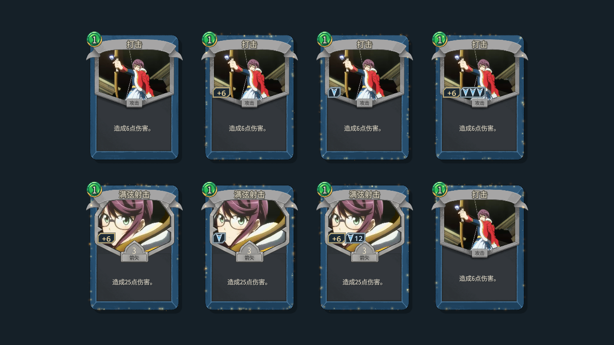

# 卡牌加成左移与卡框粒子特效

## Original user input

> $worktree-task 修改下伤害加成和额外次数的显示位置，现在在右侧，需要改到左侧。然后需要设计一个粒子特效。有获得过任意加成的卡牌边框上都带有这个粒子特效。这个特效可以参考炉石传说中的“污手”效果（给手牌随从加身材）

> 堆叠的知识牌，hover时应该允许使用鼠标滚轮切换卡牌

> 去掉之前左键点击进入平铺展示界面的操作，还原回点击直接获取的逻辑。（保留右键点击进入平铺展示界面的操作）

> 发现当前端口冲突，需要现在注意：我的全卡测试原使用15737，基线230场景完成后重启；你 artifacts/bonus-vfx-game 的PID1752在空档绑定了15737，我重启日志报EADDRINUSE后才发现。期间我向15737尝试过 singleplayer / JUNNA / embark / choose_map_node 0 / unlock all 与 junna_probe speed、junna_branches（后两者返回无战斗/命令不存在），部分请求可能到了你的新实例，请核对当前场景。我现在迁移到空闲15747，不再调用15737，也没有终止或修改你的游戏文件。请继续使用15737。

> 合并到 main

## Brief task plan

- 起点：`main`，`e4aae718fb0ec202b6213c893b21ab29c0aeeba3`；工作树：`../worktrees/STS2_ShoujoKagekiJunna/card-bonus-border-vfx-20261105`。
- 原检出有未提交的工作台数据修改，保留原样；任务基于已提交版本。
- 将现有伤害加成及额外次数嵌条移到卡图左侧，保持样式与牌效。
- 制作沿卡框流动的暖金色粒子，获得任意加成的实际卡牌持续显示；复用现有卡牌生命周期。
- 仅做构建及相关显示、状态的定向验证，准备实际效果录像。
- 堆叠知识牌悬停时用滚轮切换牌面与提示，保持原获取对象；左键直接获取、右键保留平铺预览。
- 完成后合并前、清理前分别请求确认。

## Result and changes

- 伤害加成与额外次数嵌条沿卡图底边靠左排列，保留按内容收缩、1～3 次逐枚箭头、4 次起图标加数字和大数缩放。悬浮箭矢的额外次数也放到左侧。
- 新增 `src/Combat/CardBonusVfx.cs`：暖金色光尘贴卡框缓慢流动，获得新加成时短暂散开亮起；普通卡、箭矢卡与场上悬浮箭矢共享状态。采用 Godot 原生 CPU 粒子和运行时渐变纹理。
- `DamageModifiers` 保存本场战斗的获加成历史。仅正数伤害加成或额外次数触发；转移后历史保留，复制牌继承并独立变化，战斗结束清除。未公开牌面、无加成新牌与复用节点的显示通过检查。
- `KnowledgeCardStack` 在悬停时响应滚轮，按实际副本循环切换牌面并同步提示；移出、点击和节点复用时恢复。获取对象保持原知识组，商店堆叠沿用同一输入处理。
- `KnowledgeAcquisition` 只拦截右键预览入口；左键使用本体直接获取流程，右键平铺继续保留确认与取消。
- Release 构建、Godot 资源导入与打包通过，0 警告、0 错误。完成 98 项必要定向断言：粒子与历史 38 项、左右键获取及奖励页滚轮 36 项、遮挡与数值提示 14 项、收藏页滚轮与复用 10 项。报告另含 1 条完成标记。最终知识牌代码复核了相关 46 项，全部通过；逐项记录见 [verification.json](verification.json)。
- 最终实机录像为 23.03 秒的真实出牌演示和 11.90 秒的知识牌鼠标交互演示，均为 1280×720、30 FPS、H.264 + AAC，完整解码通过。全程最小化、静默播放并录制引擎混音；出牌环境在录制前准备。
- 本次使用端口 15737。收到端口冲突说明后核对了独立档案及小啃兽战斗；对方迁移至 15747。测试启动配置使用无 BOM 的 `override.cfg`，最小化保护与静默音频检查通过。
- 视觉参考为[炉石官方的污手党介绍](https://hearthstone.blizzard.com/en-us/news/20356127/non-printable)中的手牌强化概念；本次光尘与获得时的亮起为项目内实现。
- 已审阅已有说明文档与本次任务文档，记录采用仓库相对路径。原检出的 `AGENTS.md` 与工作台数据在任务期间有外部更新，均保留在原检出。任务代码与必要验证完成，用户已确认合并到 `main`；任务分支、工作树与测试环境保留，等待单独确认清理。

上排为无加成、仅伤害加成、仅额外一次、两项加成；下排为箭矢对应显示及加成已转移的原牌。

- [加成与粒子最终演示](../../../out/tmp/card-bonus-border/video/sts2-20261105-084019-e7590e836b024f73b57d3bd5604b8724.mp4)
- [知识牌交互最终演示](../../../out/tmp/card-bonus-border/video/sts2-20261105-084127-fefa5c5d225246199588d33ce0eebd42.mp4)
