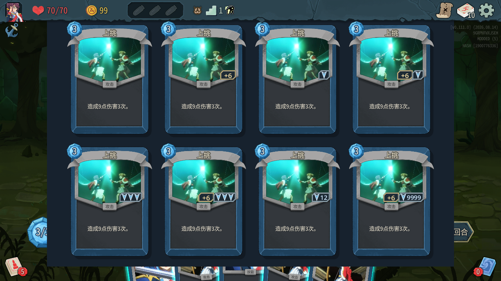
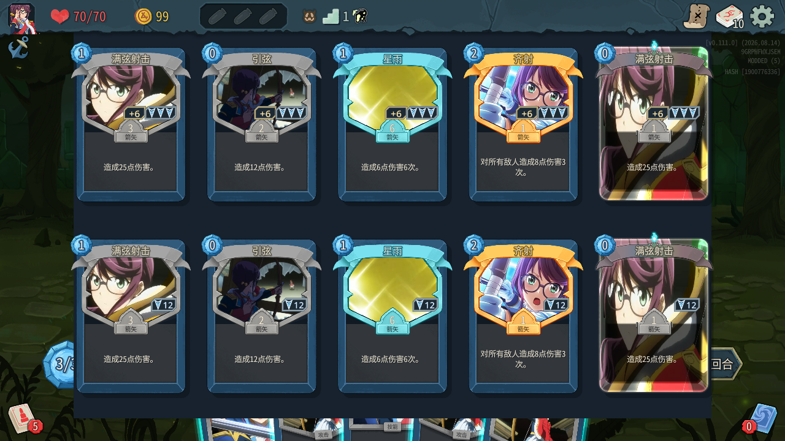

# 卡牌伤害加成与额外次数标记

## Original user input

> $worktree-task 继续处理卡牌上的伤害加成标记。你需要按，可能伤害加成不存在，但又额外次数来设计。大多数情况为只有伤害加成。还有一些情况是只有一次额外次数。还有极端情况是有很多额外次数

> 额外次数很多时：少量逐枚显示，大量改成图标加次数数字。

> 用imagegen设计各种布局各种样式，我来选选

> 按C来修改吧，别忘了更新下mcp mod

> 确认合并到 main

> 等等，你看看箭矢牌上是怎么显示的

> 各个类型都看看

> 可以，合并并清理

## Brief task plan

- 起始分支：`main`；起始提交：`66f68653795824b6e8167ff748685ca5ecc07d1c`。
- 任务分支：`codex/card-investment-marks`；工作树：`../worktrees/STS2_ShoujoKagekiJunna/card-investment-marks`。
- 原工作区的 `docs/design/data/纯那Mod设计工作台_本地编辑.json` 有未提交修改，原样保留。
- 查看已有标记与卡面布局，让伤害数值与额外次数能分别独立显示，并控制大量次数时的占用空间。
- 1～3 次显示独立箭头，4 次起显示单个箭头和次数，两类标记按内容收缩。
- 只执行构建和标记显示所需的定向验证；完成一个任务提交，经过确认后合并和清理。
- 使用内置 imagegen 提供 8 种布局与材质候选，并按用户选定的 C 实现底边横向嵌条，避开类型标签及箭矢倒计时。
- 同步最新本地 MCP 模组到游戏安装目录、原工作区缓存和本次测试环境，并验证加载。
- 用户要求补充各类牌面对照，检查完成后确认合并与清理。

## Result and changes

- `src/Combat/CardInvestmentMarks.cs` 使用选定的 C 型底边嵌条。伤害数值在左、额外次数在右，单项存在时贴右收紧，两项存在时共用 32 个卡面单位的高度。使用深色金属底、灰色斜切边框及金色／蓝色标记。
- 次数数字按字体宽度布局，超过卡图可用宽度时整体缩放，大数字变小时恢复。绘制箭头最多 3 枚，大量次数的绘制开销保持固定。悬浮箭矢沿用紧凑比例，仅显示额外次数。
- 普通卡嵌条位于类型标签上方。各类型复查后，箭矢卡嵌条较首版下移 20 个卡面单位，贴近卡框底边，并与回合数字区域保持至少 4 个卡面单位的间隔。卡牌转换形态时同步调整位置。
- `src/Combat/ArrowCardPresentation.cs` 在恢复原生卡框时同步更新类型标签，转换后的卡牌正确显示“攻击”或“技能”。
- `README.md` 更新显示规则与验证链接，`.gitignore` 排除 MCP 验证使用的 `out/` 临时产物。
- 提交时原工作区仍位于起始 `main` 提交；其他会话继续修改工作台数据及 `docs/design/workbench/` 下的 `app.js`、`card-model-view.js`、`card-model.css`。这些文件与本次改动互不重叠，集成时保留其当前内容。
- Junna、MCP 与临时验证程序的 Release 编译均通过，0 警告、0 错误。独立游戏中完成 14 项必要检查，覆盖组合显示、空值隐藏、底边排列、MCP 实际加载、加成转移、整数上限、数字收缩、4→3 切换、独立 1 次、原生多段卡复用、未公开牌面隐藏、悬浮模式、各稀有度箭矢卡及形态转换，全部通过。
- 已检查 9999 次与 2147483647 次的实际卡面，次数保持单行并位于卡图内。验证结果已移交到主工作区 `artifacts/card-investment-marks/c-rail-review/results.json`。
- MCP 从本地仓库提交 `6082ec5c2eb09ad87f12816f7490386af15bd7f5` 的独立源码快照构建。游戏安装目录、原工作区缓存及本次测试实例中的 DLL 哈希一致，实际加载的 MVID 为 `00c5382a-dd8f-4675-b644-402b26313689`。安装备份随临时测试环境清理。
- MCP DLL SHA256 为 `1F041A8C1D3A4EB409C5BD08AD12E222CC150607168FEF187455F3D4B9BFB70D`。游戏安装目录的 MCP 清单同步使用该提交的 `mod_manifest.json`。
- 已审阅 Git 跟踪与待加入的说明文档及选定方案提示词。工作台业务数据继续遵循项目 MCP 编辑约定。
- 各类型复查覆盖 48 张牌面预览与 8 支单体／群体悬浮箭矢。牌面包括基础、普通、罕见、稀有、远古箭矢及升级版，转换后的攻击／技能牌，以及攻击、外部直伤技能、普通／X 费能力、毒技能、防御、状态和诅咒。适用卡牌显示对应强化，受检的毒技能、防御、状态和诅咒保持空标记。
- 复查数据已移交到主工作区 `artifacts/card-investment-marks/c-rail-review/types/`，已核对 1／3／12 次标记、基础与升级计数、转换标签和回合数字区域间隔。调整后重新完成 14 项定向检查。
- 独立预览实例已结束。用户已确认合并至 `main`，并清理任务分支、工作树及树内构建缓存、验证程序和测试游戏环境。正式源码、选定方案与实机预览随任务提交保存。

上排依次为无强化、仅伤害加成、仅额外 1 次、伤害加成与额外 1 次。下排依次为仅额外 3 次、伤害加成与额外 3 次、仅额外 12 次、伤害加成与额外 9999 次。

箭矢图从左至右依次为基础、普通、罕见、稀有、远古。上排为伤害 +6 与额外 3 次，下排为仅额外 12 次。

| 实机对照 | 预览 |
| --- | --- |
| 箭矢仅加成／仅额外 1 次 | [查看](arrow-single-preview.png) |
| 箭矢基础／升级版本 | [查看](arrow-upgrade-preview.png) |
| 攻击、技能、能力、状态、诅咒 | [查看](card-types-preview.png) |
| 箭矢转换后的攻击／技能牌 | [查看](converted-preview.png) |
| 单体／群体悬浮箭矢 | [查看](floating-preview.png) |

### Imagegen 视觉候选

已使用内置 imagegen 生成 8 张候选，各图按左上、右上、左下、右下顺序展示仅伤害 +6、仅额外 1 次、伤害 +6 与额外 3 次、仅额外 12 次。用户选择 C，设计原图保存在 `selected-design.png`，完整提示词保存在 `selected-design.json`。

候选及完整提示词保存在 `output/imagegen/investment-layout-styles/`：

| 文件 | 方向 |
| --- | --- |
| `A.png` | 金属角标 |
| `B.png` | 侧边挂签 |
| `C.png` | 底边嵌条 |
| `D.png` | 左右分置圆徽 |
| `E.png` | 皮革箭袋 |
| `F.png` | 珐琅星章 |
| `G.png` | 纸页批注 |
| `H.png` | 极简刻印 |

完整候选图片与 `prompts.json` 已移交到主工作区 `output/imagegen/investment-layout-styles/`。选定的 C 图和提示词随任务提交保存。
