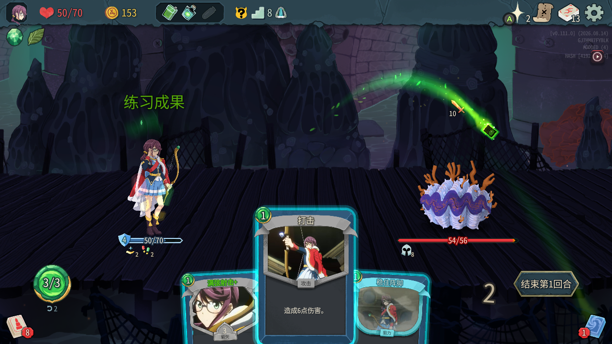
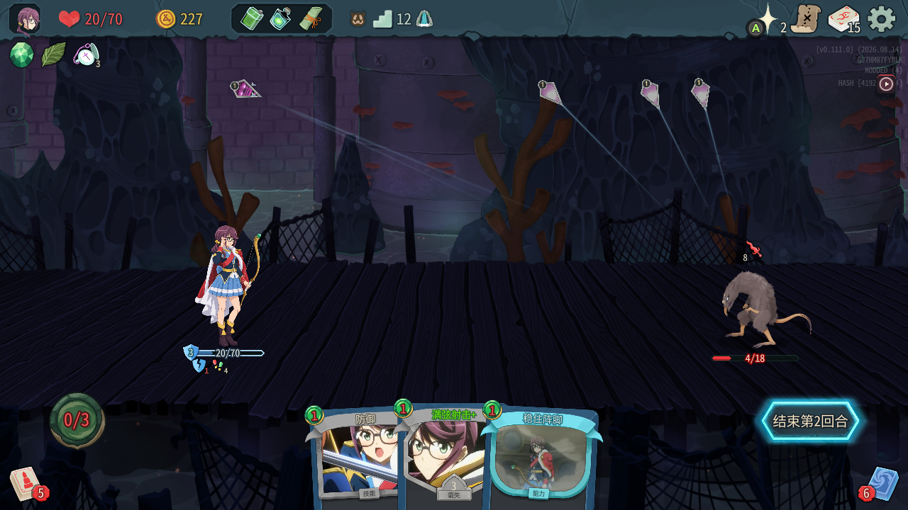
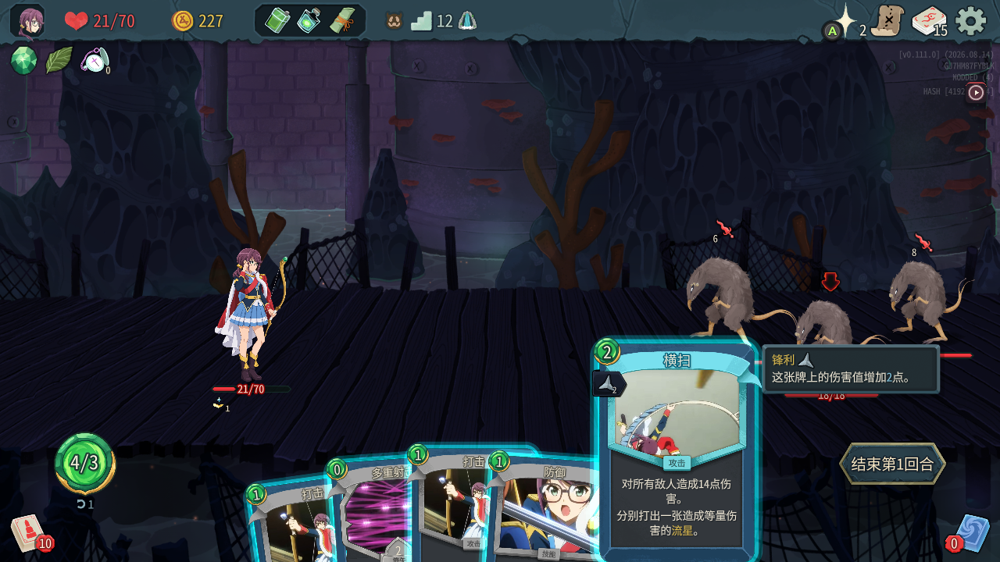
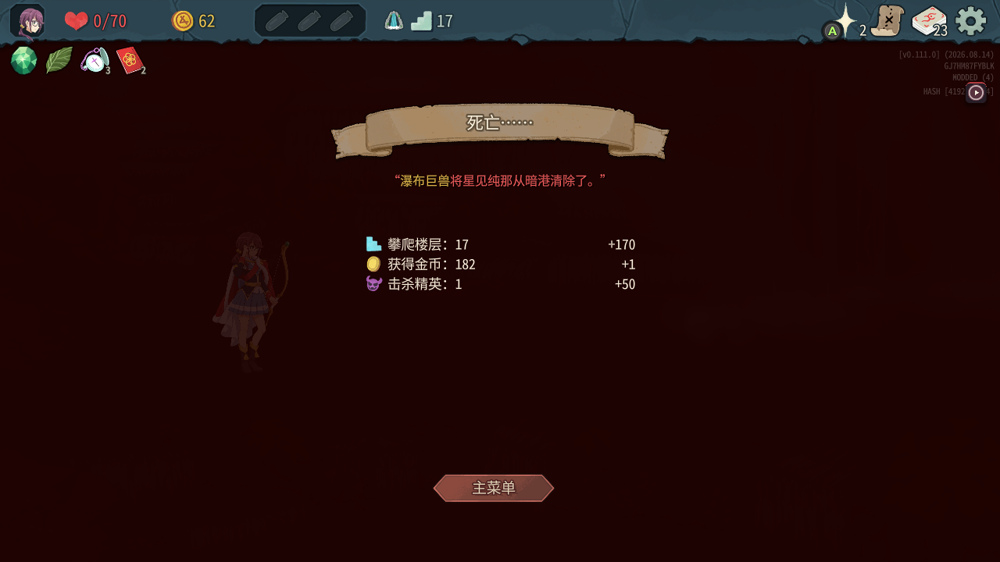

# 纯那进阶 0 试玩记录

2026-11-07，以当前 main 已提交版本进行一局标准模式实战。正式局用时 **35 分 41 秒**，止于**第一幕第 17 层瀑布巨兽的蒸汽终结攻击**。本局失败，历史标记为未放弃。

## 版本与操作条件

- 基线：`e785c3815c8a0417a55bc3ae53f539a5ff5018e4`，卡池 revision **3725**。原目录的未提交修改保留在原目录。
- 游戏：`v0.111.0`，Junna Beta 运行分支，Core **1.0.1**，BaseLib **3.4.7**。
- 纯那、进阶 **0**、标准模式、种子 **GJ7HM87FYBLK**。种子由标准开局生成，记录用于复现。
- 独立存档、随机回环端口、1280×720，最小化和静默播放，内部游戏声音录制。启动前台采样为 **0/120**。
- 新档先用一局准备局执行满解锁并核对基础箭矢，随后放弃准备局；正式局从涅奥开始。隔离档案的两次失败分别对应准备局和正式局。
- 正式局沿可达地图前进，共 8 场普通战、1 场精英战、1 场 Boss 战，经过事件、商店、宝箱和两个休息点。

## 问题记录

### B01 · P2 · 待生效伤害加成未进入卡面预览

**位置：第 8 层下水道蚌，第 1 回合；完整录像 08:13–08:18。**

1. 打出挥刃练习，获得“练习成果 2”。
2. 悬停一张普通打击，并指定下水道蚌为预览目标。
3. 卡面仍显示“造成 6 点伤害”；敌人为 54 血、0 格挡。
4. 实际打出后，敌人降到 46 血，实际伤害为 **8**。

实际伤害包含了加成，悬停预览少算 2 点，影响斩杀判断。第 6 层也出现过同样的 6/8 差异。

相关位置：`src/Models/JunnaNextCardBonus.cs` 的出牌前加成，以及 `src/Combat/Damage/DamagePatches.cs` 的预览计算。修复时应让预览包含将由当前牌取得的加成，并保持实际只结算一次。

### B02 · P2 · 首次攻击击倒目标后，双星仍付费重复，伤害部分落空

**位置：第 12 层双尾鼠，第 2 回合；完整录像 14:12–14:23。**

- 开始时有 3 点能量；存活双尾鼠分别为 **7 血、4 血**。
- 打出双星，再用挥刃练习攻击 7 血目标。
- 7 血目标死亡，能量降为 **0**，另一只仍为 **4 血**。
- “练习成果”叠到 **4**，表明附带效果执行了两次；重复攻击没有命中剩余存活目标。

这次重现使用分步操作与足够的结算等待。需明确死亡目标的重复策略：当前行为会为额外重复扣费，但只保留附带效果的收益。

代码与现象一致：`src/Combat/Cards/PaidReplay.cs` 在重复效果开始前付费；`src/Combat/Cards/CardEffects.cs` 的 `DealDamage` 在原目标死亡时直接返回，随后 JG36 的加成效果仍执行。修复时应统一重定向、跳过或返还费用的规则。

### B03 · P3 · 横扫和连射缺少生成流星的说明

**位置：第 12 层横扫悬停；完整录像 13:10–13:20。**

横扫写着“分别打出一张造成等量伤害的流星”，悬停只出现附魔“锋利”的提示，没有流星卡面或箭矢提示，无法从这张牌查看流星的等待回合。连射的提示数据也没有流星说明。

`src/Models/Cards.cs` 的 `ExtraHoverTips` 目前按“箭矢”字样、卡牌自身类型和知识关联生成提示，没有为“流星”补充关联卡面。建议对引用流星的牌增加对应卡面与箭矢说明。

### B04 · P2 · 学无止境错误地要求选择敌人

**位置：第 15 层精英战，第 1 回合；完整录像 21:36–21:48。**

学无止境的当前牌效为获得能量、升级时获得新知、消耗，实际目标类型却是 **AnyEnemy**。本局指定花园幽灵鳗后打出，能量由 **4 增至 6**，敌人生命不变。

`data/card-pool.json` 中 JK82 同时记录 `damageCapable: false` 和 `target: AnyEnemy`。应调整为自身目标；保留当前能量、知识与升级效果。

## 建议的优化顺序

1. **先修 B01 伤害预览和 B04 学无止境目标。** 它们直接影响操作判断，已有明确的前后数值与配置依据。
2. **统一 B02 的重复目标策略。** 普通攻击与待触发箭矢应使用一致的死亡目标处理；建议重复攻击重新选择存活的有效目标，无法合法重复时处理额外费用。
3. **补齐 B03 的生成卡说明。** 横扫、连射直接提供流星卡面和等待回合提示，减少对机制的猜测。
4. **给长帧加时间定位。** 在现有性能数据旁记录当前场景、动作和时间，先分辨资源首次加载、动画或结算造成的长峰值，再决定预加载或缓存调整。

对主目录当前 revision 3746 做了只读对照：学无止境仍为 AnyEnemy；死亡目标提前返回、按已有加成快照计算预览、缺少流星关联提示的相关逻辑仍存在。上述实测证据对应 revision 3725。

## 卡顿与操作接口观察

### P01 · 录制采集出现长峰值

| 指标 | 正式录像结果 |
| --- | ---: |
| 视频标称帧率 | 15 fps |
| 实际平均采集 | 14.898 fps |
| 平均采集耗时（含主线程排队） | 17.041 ms |
| 最大采集耗时 | **1519.865 ms** |
| 成功采集 / 补帧 | 33306 / 228 |
| 编码队列丢帧 | **0** |
| 编码管道平均 / 最大写入 | 0.451 / 132.908 ms |

这是 15 fps 录制管线的数据。约 24 分钟时最大采集耗时为 603.611 ms，整局结束时升至 1519.865 ms；当前采样没有给出峰值对应的具体操作。密集流星和四敌人场景中未见持续冻结，保留此峰值作为性能排查线索。

日志有原生 `Invalid Task ID` 与多次 `Asset not cached`。不能仅凭这些日志把峰值归因于某张卡。

### T01 · 快速 MCP 请求可能先返回成功，之后动作取消

第 11 层双星结算期间，操作桥曾以约 650 ms 间隔继续请求出牌。横扫请求返回 `ok`，随后因前面的重复效果消耗能量而取消；日志出现一条 `PlayCardAction ... JUNNA_JA76 ... Canceled` 错误。本局继续运行。

随后改为分步操作并等待 2.3–6.5 秒，后续未再出现同类日志。此项保留为接口时序问题，不能把请求响应直接当成实际出牌或结算结果；B01/B02/B04 使用生命、能量和状态前后值核对。

## 结算核对

- 准备局的放弃、正式局死亡页、计分摘要和返回主菜单均可完成。
- 正式历史：`ascension=0`、`win=false`、`was_abandoned=false`、17 个地图点，死因为瀑布巨兽，牌组 23 张、遗物 4 个。
- 收入 **182** 金币，商店花费 **199**，地精偷走 **20**；余额核对：**99 + 182 − 199 − 20 = 62**。
- 计分条目为楼层 **170**、金币 **1**、精英 **50**，三项合计 **221**，与本局记录一致。
- 返回主菜单后 `current_run=null`，没有残留进行中的正式局。
- Boss 蒸汽阶段实际界面显示无穷生命。接口暴露的 999999999 是原生阶段占位值，不列为纯那 UI 问题。
- 最后回合为 **18 血、9 格挡、30 点终结攻击**。速度药水在前一回合使用，本局将这次死亡记为操作失误。

## 已观察到的正常行为

- 双星重复箭矢可合并显示；同目标死亡后，另一支待触发箭矢能够转向其他存活敌人。
- 手札奖励同时获得两张关联牌；两个分支均使用过，闪耀耗尽后两张牌移出牌组，计数为 2。
- 学无止境商店购买一次即获得完整知识组；新知、引言与零费重复抽牌能够完成。
- 满弦射击升级预览为 25→32；格挡、余星保留、虚弱与稳住阵脚加速在核对场景中符合实际数值。
- 四敌人精英战两回合结束，生命保持 19；六支箭矢的布局已留在完整录像中。

## 证据与验证

- [脱敏摘要、路线和构建指纹](evidence/summary.json)
- [关键结算状态及卡牌定义](evidence/settlement-samples.json)
- 问题片段：`out/tmp/junna-a0-playtest-20261107/junna-a0-issues.mp4`，约 78 秒，有声，带问题编号；声音较原片提高 10 dB。
- 完整正式录像：`out/tmp/junna-a0-playtest-20261107/junna-a0-full-run.mp4`，37 分 15.6 秒，保留原始内部游戏声音。
- 原始请求、游戏日志、准备局录像、原始历史和逐回合截图保存在同一忽略目录。
- Beta、Stable 和加载器构建通过；测试包 DLL/PCK 与部署到隔离实例的文件哈希一致。录像状态为 completed，H.264/AAC 双轨已核对。

本次结束于第一幕死亡结算，第二、三幕和胜利结算尚未覆盖。
