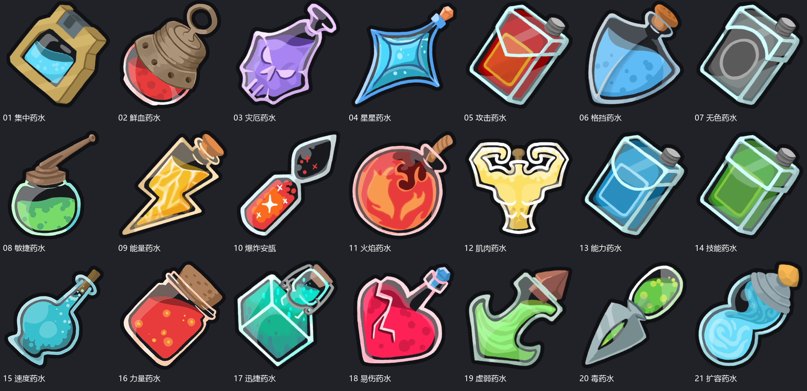
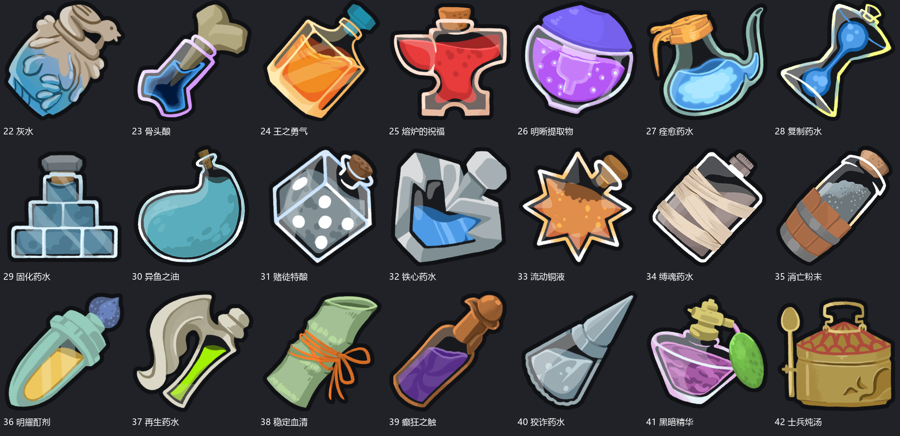
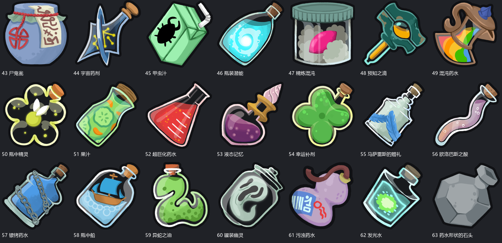

# 本体药水图标的形状、颜色与装饰

核对范围：本地本体提取快照中的全部63张药水图标（普通20、罕见20、稀有20、事件2、衍生1），逐张按256×256原尺寸观察。以下设计思路由成图反推；图像摘要见[native-potions.json](native-potions.json)。

## 从成图反推的设计思路

**先让轮廓或一个主物件表达主题，再用液体配色和简洁的材质画法把它统一成药水。** 不要求每瓶同时叠加特殊瓶形、符号、内容物和挂件。

| 观察维度 | 本体怎样处理 | 对箭雨药水的应用 |
| --- | --- | --- |
| 形状 | 星星、能量、肌肉、铁砧、四叶草直接成为瓶形；攻击、技能、能力也可复用一族轮廓，通过色彩辨认。瓶、纸盒、锅、瓮都能成为消耗品。 | 箭头式玻璃药瓶保留尖角，以侧壁、厚底、瓶沿、瓶颈和嵌入木塞形成可信的盛装容器。 |
| 颜色 | 多数围绕一个占主导的液体色系，以较亮与较暗的大色块分层。玻璃边线随配色采用浅青、粉紫、米白或淡黄；木塞、金属和布保持材质色。等级没有统一色卡。 | 延续此前紫色身份，以紫色液体、深梅紫阴影、浅灰紫玻璃边和棕色木塞构成清楚层次。 |
| 装饰 | 主要识别点通常集中在一处：骨塞、链条、布带、骰点、船或幽灵。气泡与反光主要补充液体和玻璃质感；它们不替代主轮廓。 | 只保留少量气泡和宽高光，不再塞入三支箭。 |
| 画法 | 深色外轮廓包住浅色玻璃边；短而宽的高光、可见液面、硬边明暗与少量块面，整体有轻微手绘不规则感。 | 用侧面和厚玻璃底、液面与上方空腔表达实际容积；先画正立图，确认瓶口、瓶颈和木塞同轴，再整体旋转，保留简洁色块和各部件的相对位置。 |
| 小尺寸 | 不同图标通过长宽比、缺口、凸角、瓶口和斜向摆放形成差异。缩小后仍先看到整个物件。 | 在32与64像素检查瓶口、液面、侧壁和箭头式轮廓。 |

三种常见处理方式可以组合：让主题进入外形（星星、闪电、屈臂）；让具体物件进入容器（船、精灵、羽毛）；让容器或材料承担主题（饭锅、陶瓮、纸盒、石头）。稀有药水也可以只靠简单轮廓成立，例如幸运补剂与超巨化药水。

本次重绘以箭头式瓶身承担主题，同时要求瓶口、玻璃壁厚、侧面和液面构成实体药瓶。尖角可以保留，内容物为药液。知识药水由学习物件承担主题；运动饮料v10以收腰运动瓶和推拉壶嘴承担训练补给主题，详见[sports-drink-redesign.md](sports-drink-redesign.md)。三瓶保持不同主轮廓。

## 63张逐项观察

| 序号 | 药水 | 形状 | 颜色 | 装饰元素 |
| ---: | --- | --- | --- | --- |
| 1 | 集中药水 | 硬折角框架，中央露出药液 | 金黄外壳、青蓝液体 | 粗框、简化气泡 |
| 2 | 鲜血药水 | 圆腹小瓶，上端大金属盖与拉环 | 血红、铜褐 | 铆钉状孔点、拉环 |
| 3 | 灾厄药水 | 瓶身下部直接构成骷髅脸 | 紫、浅紫边 | 眼眶和鼻孔的大块负形 |
| 4 | 星星药水 | 四角内凹星形瓶 | 青蓝、深蓝 | 同心边线、少量气泡 |
| 5 | 攻击药水 | 斜置扁方瓶，短颈旋盖 | 红橙、浅青边 | 大块多边形标记、横向瓶肩高光 |
| 6 | 格挡药水 | 上宽下收的盾形腹 | 蓝、浅蓝灰边 | 液面、圆气泡 |
| 7 | 无色药水 | 与攻击药水同族的扁方瓶 | 灰、黑、浅青边 | 椭圆标记 |
| 8 | 敏捷药水 | 圆腹瓶，长而斜的木质塞杆 | 绿、棕 | 长塞杆成为轮廓差异 |
| 9 | 能量药水 | 瓶身直接折成闪电 | 黄橙、米黄边 | 液体中的白色折线 |
| 10 | 爆炸安瓿 | 两端拉尖的玻璃安瓿 | 橙红、灰青边 | 中央白色爆闪、少量火星形点 |
| 11 | 火焰药水 | 近圆扁瓶 | 红橙 | 一枚大火焰形色块 |
| 12 | 肌肉药水 | 双臂屈起的躯干轮廓 | 金黄、米白边 | 胸腹明暗与气泡 |
| 13 | 能力药水 | 与攻击药水同族的扁方瓶 | 蓝、青白边 | 浅色多边形标记 |
| 14 | 技能药水 | 与攻击药水同族的扁方瓶 | 绿、青白边 | 浅色多边形标记 |
| 15 | 速度药水 | 圆腹细颈，底部短凸角 | 青蓝、浅青边 | 几枚大气泡、细颈亮点 |
| 16 | 力量药水 | 斜置方腹玻璃瓶，大木塞 | 红、橙黄气泡 | 清晰液面、木塞孔点 |
| 17 | 迅捷药水 | 多面方瓶，瓶口有翻盖结构 | 蓝绿、浅青边 | 铰接盖与大块面分割 |
| 18 | 易伤药水 | 心形瓶身，瓶口偏一侧 | 玫红、浅粉边 | 贯穿心形的单条裂缝 |
| 19 | 虚弱药水 | 两侧内凹的拼片式轮廓 | 浅绿、灰绿边 | 分层液体色带、尖木塞 |
| 20 | 毒药水 | 细长药囊连接尖锥形外壳 | 黄绿、金属灰 | 尖锥大开口、绿色气泡 |
| 21 | 扩容药水 | 上下相连的双圆腹 | 青蓝、灰蓝 | 绕颈金属片、旋涡色块 |
| 22 | 灰水 | 面具状瓶体，上部绕布和绳 | 灰蓝、米褐 | 面部凹凸、布结 |
| 23 | 骨头酿 | 短而不规则的瓶身，巨骨作塞 | 深蓝、淡紫边、骨灰黄 | 骨头占据上半轮廓 |
| 24 | 王之勇气 | 斜置方腹、短颈金属盖 | 橙金、米黄边、蓝绿盖 | 大块斜向亮暗面 |
| 25 | 熔炉的祝福 | 瓶体直接采用铁砧轮廓 | 红、粉灰边 | 铁砧凹口、圆气泡 |
| 26 | 明晰提取物 | 被斜边分开的球形容器 | 紫、浅紫边 | 脑形或神经状浅色主体 |
| 27 | 痊愈药水 | 圆腹连接长弯嘴 | 浅蓝、灰绿边、橙盖 | 一团浅色云状液体 |
| 28 | 复制药水 | 沙漏形两端鼓起、中腰收窄 | 蓝、淡黄边 | 上下两枚同色圆体 |
| 29 | 固化药水 | 砖块逐层堆叠的阶梯瓶 | 钢蓝、灰白边 | 砖缝与块面 |
| 30 | 异鱼之油 | 歪向一侧的豆形圆腹 | 灰青蓝、浅灰边 | 朴素木塞、少量液体斑点 |
| 31 | 赌徒特酿 | 立方骰子形玻璃瓶 | 灰、白、浅蓝 | 白色骰点 |
| 32 | 铁心药水 | 屈臂形厚重瓶体 | 金属灰、蓝 | 宽金属切面、内部蓝色块 |
| 33 | 流动铜液 | 多尖角放射轮廓 | 铜橙、淡黄边 | 小气泡、明确液面 |
| 34 | 缚魂药水 | 普通扁方瓶被布带包裹 | 灰、米白 | 几道大宽布带 |
| 35 | 消亡粉末 | 细长圆筒瓶，底部套木壳 | 灰黑、棕 | 颗粒状粉末、木壳箍环 |
| 36 | 明耀酊剂 | 细长尖腹，厚外套包住瓶身 | 黄、薄荷绿、蓝紫塞 | 黄色内窗、孔点瓶塞 |
| 37 | 再生药水 | 弯曲宽刃式轮廓接窄瓶管 | 骨白、荧绿 | 宽刃负形、窄绿药液窗 |
| 38 | 稳定血清 | 竹节或卷叶式长筒 | 淡绿、橙 | 一根系绳、几道节纹 |
| 39 | 癫狂之触 | 细长管瓶配夸张长塞 | 紫、棕橙 | 顶部圆端、简化液体波纹 |
| 40 | 狡诈药水 | 匕首式长尖塞与三角瓶腹 | 冷灰、浅蓝灰 | 尖刃、少量气泡 |
| 41 | 黑暗精华 | 扁腹香水瓶，带挤压球 | 紫、绿、黄褐 | 一枚骷髅形内容、挤压球 |
| 42 | 士兵炖汤 | 有盖的金属饭锅 | 金褐、红 | 侧挂勺子、锅盖大纹样 |
| 43 | 尸鬼瓮 | 宽腹陶瓮 | 灰蓝、米白、红 | 封口布、绳结与符纸 |
| 44 | 宇宙药剂 | 细长瓶身穿过环形结构 | 蓝、灰蓝、黄 | 轨道环、少量星点连线 |
| 45 | 甲虫汁 | 带吸管的纸盒 | 浅绿、黑、白 | 一枚黑色甲虫剪影 |
| 46 | 瓶装潜能 | 短颈泪滴瓶 | 亮青蓝、白 | 中央发亮圆核与环形色块 |
| 47 | 精炼混沌 | 宽口直壁玻璃罐 | 灰绿、灰白、亮粉 | 一枚粉色主体、几团灰色块 |
| 48 | 预知之滴 | 滴管形细尖端连接眼形头 | 深青绿、金黄 | 一枚大眼睛、滴管尖端 |
| 49 | 混沌药水 | 扭曲折返的异形瓶 | 彩虹、棕 | 大块彩色液体、卷曲瓶口 |
| 50 | 瓶中精灵 | 多瓣花形瓶 | 黄绿、黑灰 | 中央一只简化带翅精灵 |
| 51 | 果汁 | 宽腹窄口饮料瓶 | 浅绿、橙、褐 | 几片果实切面 |
| 52 | 超巨化药水 | 锥形实验烧瓶 | 红、粉白边 | 几条粗白刻度 |
| 53 | 液态记忆 | 侧偏瓶口的心形瓶 | 紫、粉白、金褐 | 螺纹尖塞、少量气泡 |
| 54 | 幸运补剂 | 四叶草形瓶 | 绿、浅黄边 | 叶片大色块、少量气泡 |
| 55 | 马萨雷斯的赠礼 | 方腹旋颈瓶 | 浅青白、蓝 | 几根蓝色羽毛 |
| 56 | 欧洛巴斯之酸 | 横向弯曲的长管瓶 | 淡粉、淡紫、浅灰边 | 少量圆泡、两端渐变色区 |
| 57 | 镣铐药水 | 宽肩方腹壶 | 蓝、灰青边 | 两道醒目的金属链 |
| 58 | 瓶中船 | 上窄下宽的斜方腹瓶 | 蓝、白、木褐 | 一艘有帆小船 |
| 59 | 异蛇之油 | 蛇形回弯瓶身 | 浅绿、深绿、橙塞 | 蛇形轮廓与斑点 |
| 60 | 罐装幽灵 | 歪置宽口罐 | 灰绿、灰白、黑 | 一张大幽灵脸 |
| 61 | 污浊药水 | 双腹葫芦形容器 | 淡紫、暗红、蓝白 | 软管或角形塞、瓶身标签 |
| 62 | 发光水 | 削角短颈扁瓶 | 青蓝、荧黄绿 | 中央一枚亮色放射斑 |
| 63 | 药水形状的石头 | 带瓶口的多面石块 | 灰 | 宽大石面与少量斑点 |

## 原尺寸核对图

来源：`<vanilla-extraction>/extraction/raw/images/potions/*.png`，与现有63条清单逐张同摘要。机读观察记录见[native-potion-icon-observations.json](native-potion-icon-observations.json)。
