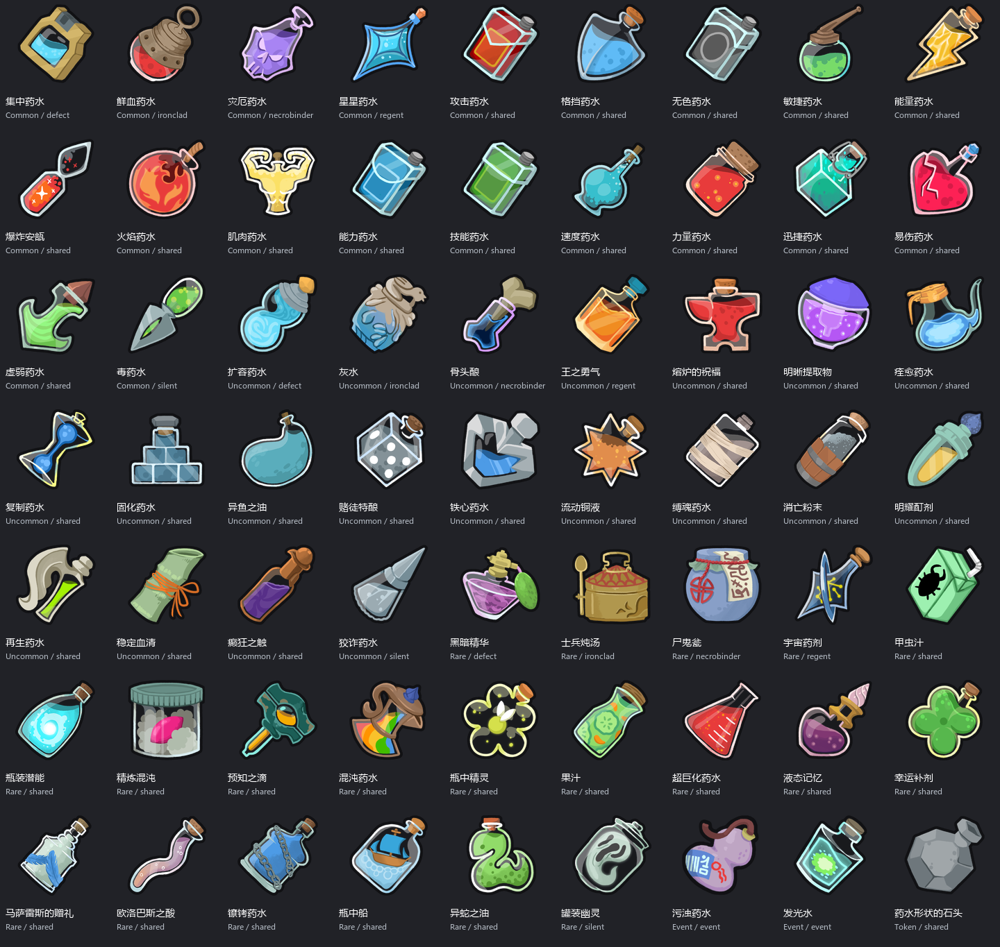

# 本体药水的命名与图标特点

核对日期：2026-11-11。范围为本地本体提取快照中的63种药水；中文名称逐条匹配本体中文文本，63张图标逐张用SHA-256匹配提取原图。名称与文件摘要见 [native-potions.json](native-potions.json)。

## 命名

| 稀有度 | 样本数 | 名称以“药水”结尾 | 典型例子 |
| --- | ---: | ---: | --- |
| 普通 | 20 | 19 | 攻击药水、格挡药水、集中药水、星星药水；例外为爆炸安瓿 |
| 罕见 | 20 | 8 | 灰水、骨头酿、王之勇气、明晰提取物、稳定血清 |
| 稀有 | 20 | 3 | 士兵炖汤、尸鬼瓮、罐装幽灵、瓶中船、黑暗精华 |
| 事件／衍生 | 3 | 1 | 污浊药水、发光水、药水形状的石头 |

普通药水多用“收益、资源或状态＋药水”，名字直接对应效果。罕见和稀有更常采用材料、制剂、容器或一个可以想象的具体物件。“液态记忆”“瓶装潜能”“精炼混沌”“预知之滴”通过简短意象关联机制。稀有度与后缀之间没有固定对应。

本体药水名称通常是短名词。它们可以直接说功能，也可以为世界中的消耗品命名；台词和歌词不是这批名称的统一来源。

五职业在这份快照中，各有普通、罕见、稀有专属药水各一瓶：

| 职业 | 普通 | 罕见 | 稀有 | 主要身份线索 |
| --- | --- | --- | --- | --- |
| 铁甲战士 | 鲜血药水 | 灰水 | 士兵炖汤 | 血、灰烬、士兵补给 |
| 静默猎手 | 毒药水 | 狡诈药水 | 罐装幽灵 | 毒、刀刃、幽灵 |
| 故障机器人 | 集中药水 | 扩容药水 | 黑暗精华 | 集中、球位、黑暗充能球 |
| 亡灵契约师 | 灾厄药水 | 骨头酿 | 尸鬼瓮 | 灾厄、骨、亡灵器物 |
| 储君 | 星星药水 | 王之勇气 | 宇宙药剂 | 星星、王权、宇宙 |

## 图标

全部63张图标的形状、颜色、装饰逐项观察和设计归纳见[native-potion-icon-design.md](native-potion-icon-design.md)。

这63张原图均为256×256，具有透明背景。它们是独立的物件图标：药瓶、罐、锅、瓮、安瓿等。小尺寸识别主要依靠以下特征：

- **清楚的整体轮廓。** 深色粗外描边，较大的连续色块，简化明暗，玻璃上保留少量明亮高光。
- **先认形，再认颜色和内容。** 攻击、技能、能力药水使用相近的扁瓶、不同的液体颜色；肌肉药水的轮廓像屈臂，能量药水像闪电，星星药水采用四角星瓶形。
- **把名字变成物件。** 骨头酿以骨形瓶塞辨认，士兵炖汤直接画锅，尸鬼瓮画罐和符纸，瓶中船装一艘小船，罐装幽灵装幽灵。
- **瓶形、瓶塞、液体与一个主符号配合。** 精炼混沌使用罐子和内部的彩色形体，镣铐药水有链条，赌徒特酿具有骰子特征。
- **稀有度不统一决定瓶形或液体颜色。** 不同等级都出现蓝、绿、紫等配色，区分度主要来自物件与构图。

## 对三瓶职业药水的应用

三条设计已通过MCP保存至契合池「职业药水」，r4891完成命名和首版配图，r4892替换为对照本体实际图标的重绘版：

| 编号 | 条目 | 效果 | 图标方向 |
| --- | --- | --- | --- |
| JP01 | 知识药水（普通） | 从3组随机知识牌中选择1组加入你的手牌。这些牌在本回合可以免费打出。 | 药瓶与一处明确的书本／纸页元素，关联获取和运用知识 |
| JP02 | 运动饮料（罕见） | 所有手牌获得9点伤害加成。 | 收腰握持的透明运动瓶、蓝绿色运动壶嘴与橙金饮料，关联日常锻炼与训练补给 |
| JP03 | 箭雨药水（稀有） | 打出你的所有箭矢。 | 具有侧壁、厚玻璃底和圆形瓶口的箭头式实体药瓶，配紫色药液与木塞 |

三瓶采用不同主轮廓和瓶内物。知识药水直接以机制命名；运动饮料使用具体训练补给品；箭雨药水采用射术中的常用动作名。成品、提示词、本地清理和本体对照见[药水图标](../../design/assets/potions/2026-11-11/README.md)。

## 来源与验证

- 名称、稀有度与职业池：`<vanilla-extraction>/data/potions.json`。
- 中文原文：`<vanilla-extraction>/extraction/raw/localization/zhs/potions.json`。
- 图标原图：`<vanilla-extraction>/extraction/raw/images/potions/*.png`；与`backend/static/images/potions/*.png`逐张同摘要。
- 模型与职业池：`<vanilla-extraction>/extraction/raw/src/Core/Models/PotionModel.cs`、`Core/Models/PotionPools/`及`Core/Models/Potions/`。药水模型从potion atlas读取独立图标和轮廓。
- MCP保存：r4887新增三条药水与风格约定；r4888精简出处字段。最终公开快照r4892的字段与图片摘要核对见 [public-art-v2-verification.json](public-art-v2-verification.json)。早期保存回读见 [public-verification.json](public-verification.json)。
- 原始请求、回执与回读分别见 [workbench-changes.json](workbench-changes.json)、[workbench-receipts.json](workbench-receipts.json)、[workbench-readback.json](workbench-readback.json)。
