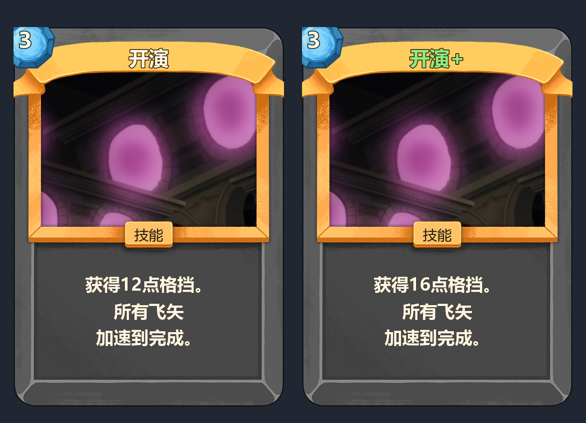
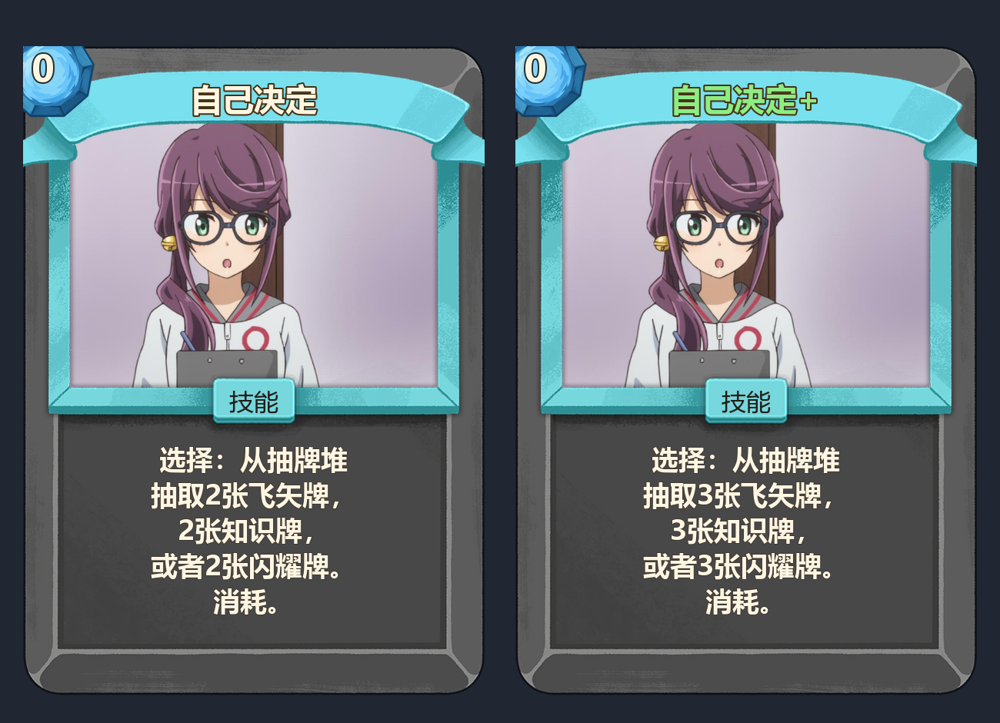
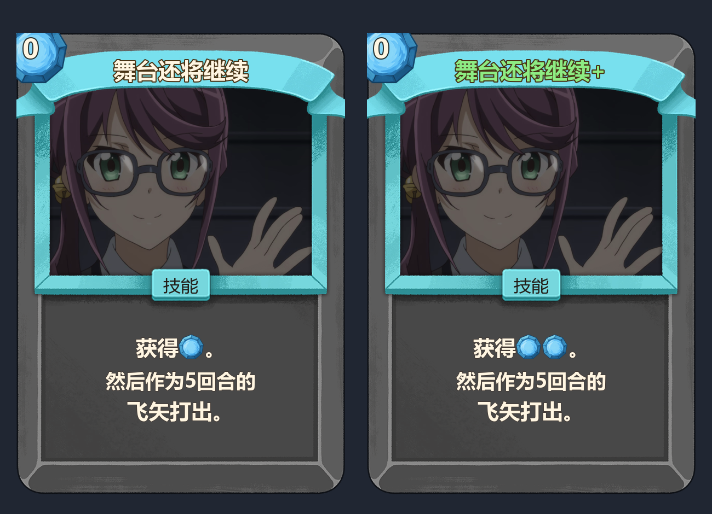

# 开演、道标、初生之光：名字与卡图

已读取工作台全部36条约定，按最新牌效选择契合。工作台已保存“开演”；以下另两张为待选方案。

## 已保存：弦声齐鸣 → 开演

用户选定“开演”。原词“始まりました”出自《舞台プレパレイション》，舞台语境译为“开演了”；卡名采用用户指定的“开演”。配图取TV第2话纯那舞台圆窗同时亮起的画面，表现此前布置的行动正式开场、集中兑现。

3费稀有技能；基础获得12点格挡，升级16点；所有飞矢加速到完成。工作台卡牌与FIT_CARD_JA71同批同步，旧内部说明的10／15格挡按当前牌面更新为12／16。保存回执r5333；已确认名称约定更新于r5334。

[原词](https://www.uta-net.com/song/261292/) · [官方曲目](https://revuestarlight.com/music/5thsinglecd/) · [截图出处](https://xenodude.com/2024/06/19/revue-starlight-ep-2/)

## 道标 → 自己决定

当前JS33为0费罕见技能：选择从抽牌堆抽取2张飞矢牌、2张知识牌或2张闪耀牌，升级各3张，消耗。

- 原词：自分で決める。
- 来源：《Regalia -継承-》，シークフェルト音楽学院中等部；作词：no_my。原句讲述由自己决定前进的方式，中文自然译为“自己决定”。
- 契合：先决定当前需要哪类资源，再取得相应的牌。
- 卡图：TV第11话，纯那持工作表向同学报告舞台创造科的安排。她实际统筹舞台事务的动作承接选择与调度，构图聚焦纯那本人。

[原词](https://www.uta-net.com/song/326249/) · [官方曲目](https://bushiroad-music.com/musics/brmm-10570/) · [原帧](https://i.imgur.com/fzxiHGW.jpeg) · [第11话截图讨论](https://www.reddit.com/r/anime/comments/v2sqe8/revue_starlight_rewatch_episode_11_discussion/)

备选“答案就在手中”：同曲连续原词“答えはこの手の中に”，可配纯那送来英语参考书的画面，体现从知识中找到可用资源。主方案能更直接覆盖飞矢、知识、闪耀三种选择。

## 初生之光 → 舞台还将继续

当前U_CARD_025为0费罕见技能：获得1点能量，升级2点；然后作为5回合飞矢打出。完成时再次获得能量并重新布置，形成循环。

- 原词：ステージは続く。
- 来源：《私たちはもう舞台の上》，スタァライト九九組；作词：中村彼方。“舞台还将继续”保留原句的延续含义。
- 契合：按舞台掌控的主体系处理五回合再登场；每次完成继续为后续演出提供能量。
- 卡图：TV第11话《舞台少女心得 幕间》段落，纯那挥手相约舞台。招呼下一次相见，对应本牌一次次回到舞台。
- 飞矢聚焦：x=0.37，y=0.5；使用工作台实际布局算法检查，双眼、眼镜及笑容仍可辨认，牌面保留挥手动作。

[原词](https://www.uta-net.com/song/304084/) · [官方曲目](https://revuestarlight.com/music/cinema/) · [原帧](https://i.imgur.com/pQyPRPI.png) · [第11话截图讨论](https://www.reddit.com/r/anime/comments/v2sqe8/revue_starlight_rewatch_episode_11_discussion/)

## 裁切、避重及状态

| 卡牌 | 原图 | 裁切矩形（左、上、右、下） | 输出 |
| --- | --- | --- | --- |
| 开演 | sources/xenodude-tv02-21.png，1920×1080 | 200,0,1120,690 | stage-lights-candidate.png，960×720 |
| 自己决定 | sources/JS33-tv11-planning.jpg，1920×1080 | 880,140,1900,905 | JS33-planning-candidate.png，960×720 |
| 答案就在手中 | sources/JS33-tv11-book.png，1920×1080 | 80,0,1520,1080 | JS33-book-candidate.png，960×720 |
| 舞台还将继续 | sources/U_CARD_025-tv11-return.png，1920×1080 | 350,115,1430,925 | U_CARD_025-stage-candidate.png，960×720 |

裁切去除画面边缘字幕，按比例缩放；保留原帧。精确播放秒数尚未定位，以话数、截图链接及原帧登记。

已查看纯那全部243张卡图、契合池额外18张图，以及Karen实际打包118张图，所选新构图未发现重复。旧“初生之光”与JH24“星光结界”来自同一星空画面；旧“道标”水面星光与JA100“星辉”来自同一画面，已记录为本轮换图原因。

最终名字按NFKC、空白、标点、符号及升级后缀统一后，核对纯那1150张卡、458条契合池及Karen114项卡牌title。除已经保存的JA71及对应契合池使用“开演”外，未发现重名。

“自己决定”与“舞台还将继续”保留为候选，工作台JS33及U_CARD_025当前牌效与图片未改。后续采用时同批同步名称、图片、出处、契合池及相关引用，重新读取当时版本并保留最新牌效。检验数据见verification.json，完整任务输入与记录见README.md。
